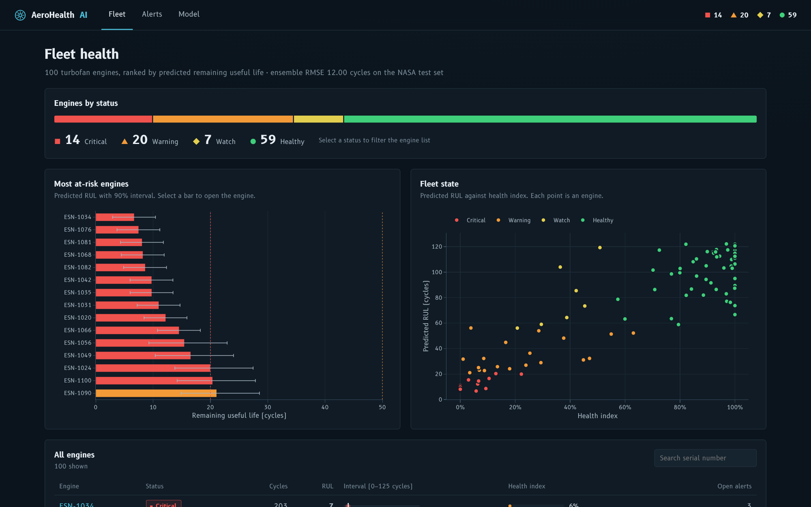
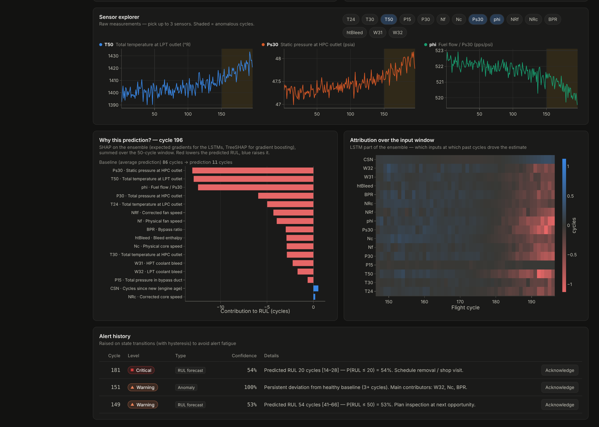

# AeroHealth AI — Predictive maintenance for turbofan engines

Engine health monitoring platform built on the NASA **C-MAPSS** turbofan degradation dataset.
It detects abnormal engine behaviour, forecasts the **Remaining Useful Life (RUL)** with a calibrated
confidence interval, explains every prediction with **SHAP**, and raises risk-based alerts in a
dashboard designed for a maintenance engineer.


| | |
|---|---|
| **ML / DL** | PyTorch LSTM deep ensemble · gradient boosting · conformal prediction · Isolation Forest · SHAP · scikit-learn |
| **Data** | pandas · operating-condition normalisation · sliding windows · PostgreSQL |
| **Backend** | FastAPI · SQLAlchemy 2 · Pydantic · pytest |
| **Frontend** | React · Plotly · Vite |
| **Ops** | Docker Compose · nginx · GitHub Actions CI |

---

## Results

### FD001 — official test set (100 engines, RUL capped at 125)

| Model | RMSE (cycles) | PHM08 score | Uncertainty | Explainability |
|---|---|---|---|---|
| **Ensemble: 3 LSTMs + gradient boosting** (served) | **12.00** | **241** | conformal 90 % interval — **89 % empirical coverage**, mean width 30 cycles | SHAP per input × cycle |
| LSTM deep ensemble (×3) | 12.95 | 263 | — | SHAP (expected gradients) |
| Single LSTM | 12.88 | 260 | — | SHAP (expected gradients) |
| Gradient boosting on window features (baseline) | 12.47 | 277 | — | TreeSHAP |
| *v1 of this project: single LSTM + MC dropout, 30-cycle window* | *14.18* | *372* | *91 % coverage, width 51 cycles* | |

### Generalisation — same pipeline retrained on every C-MAPSS subset

| Subset | Setting | Test engines | Ensemble | LSTM ×3 | GBM baseline | Interval coverage (target 90 %) |
|---|---|---|---|---|---|---|
| FD001 | 1 flight condition · HPC fault | 100 | **12.00** | 12.95 | 12.47 | 89.0 % |
| FD002 | 6 flight conditions · HPC fault | 259 | 12.02 | 13.03 | **11.75** | 86.5 % |
| FD003 | 1 flight condition · HPC + fan faults | 100 | **10.75** | 11.96 | 11.94 | 92.0 % |
| FD004 | 6 flight conditions · HPC + fan faults | 248 | **11.67** | 11.96 | 12.59 | 84.3 % |

| Anomaly detection (held-out engines, FD001) | |
|---|---|
| Engines with a persistent anomaly detected before failure | 100 % (all four subsets) |
| Median lead time before failure | **56 cycles** (47–56 across subsets) |
| False-alarm rate on the healthy portion of life | 0.35 % of cycles |

**What changed from v1, and why it works**

1. **Engine age as an input** (cycles since new, always known from the engine logbook). It tells the
   model where the engine is in its life, which the 30-cycle sensor window alone cannot.
   Ablation with the GBM: RMSE 13.50 → 12.47 on FD001, 13.97 → 12.59 on FD004.
2. **Longer window** (50 cycles, selected on validation engines) to capture the degradation trend.
3. **Ensemble of two model families.** LSTMs and gradient boosting make different errors; their
   weighted average (weight chosen on validation engines) beats each member on 3 subsets out of 4.
4. **Conformal intervals instead of MC dropout.** Residuals of held-out engines, grouped by predicted
   RUL, give intervals **40 % narrower** than v1 on average (30 vs 51 cycles) while keeping ~90 % coverage —
   and a non-parametric P(RUL ≤ threshold) for the alerts.

**Honest reading.**
- The margin over the GBM baseline is real but small on FD001 (0.5 cycle on 100 engines, i.e. within
  test-set noise), clearer on FD003/FD004, and **the baseline wins on FD002**. The case for the ensemble is
  consistency across subsets plus calibrated uncertainty and temporal explanations, not a big jump on one number.
- Coverage drops to 84–87 % on the six-condition subsets: the calibration engines are fewer than the
  diversity of regimes. Calibrating per operating condition is the obvious next step.
- Using engine age departs from the most common C-MAPSS protocol, so these numbers are not directly
  comparable to published leaderboards.

---

## Screenshots

**Fleet overview** — engines ranked by risk, predicted RUL with 90 % interval, RUL vs. health index


**Engine view: sensors & explainability** — raw sensor trends with anomalous cycles shaded, SHAP attribution per sensor and per past cycle, alert history


**Alerts** — RUL and anomaly alerts with confidence level and acknowledgement


**Model card** — test-set benchmark, learning curve, input sensors, alerting policy


---

## How it works

```
C-MAPSS raw (21 sensors, 3 settings)
   │  normalise per operating condition (KMeans on settings for FD002/FD004)
   │  drop non-informative channels → 15 sensors on FD001, + engine age (cycles since new)
   ▼
50-cycle sliding windows ─┬─► 3 LSTMs (2×64, different seeds) ── mean ──┐
                          └─► window stats (last/mean/std/slope) ─► GBM ─┴─► weighted average = RUL
                                                                              │
                     residuals of held-out "calibration" engines, by RUL bin ─┤ split-conformal
                                                                              ▼
                              90 % interval, P(RUL ≤ 20), P(RUL ≤ 50)  ──►  RUL alerts (CRITICAL / WARNING)

smoothed sensors ──► Isolation Forest fitted on healthy early life (first 30 %)
                        │  anomaly score, threshold = 99th pct of healthy data
                        │  Health Index = score rescaled healthy → end-of-life (1 → 0)
                        ▼
                    persistent anomaly (3 cycles)  ──►  ANOMALY alerts + top deviating sensors

SHAP: expected gradients on the LSTMs + TreeSHAP on the GBM, combined with the ensemble weight
      ──► contribution of each input (and, for the LSTM part, of each past cycle)
```

Key design decisions:

- **Piecewise-linear RUL target (cap 125).** Early in life, degradation is not observable; capping
  avoids asking the model to guess the unguessable. It is the standard C-MAPSS protocol.
- **Engine-level 70 / 15 / 15 split** (train / validation / calibration), so no engine leaks between
  fitting, model selection and uncertainty calibration.
- **Calibrated uncertainty.** Split-conformal prediction on engines never used for training or model
  selection, conditioned on the predicted RUL (errors are much smaller close to failure), checked on the
  official test sets.
- **Alerts on state transitions with hysteresis**, not one per cycle — maintenance teams ignore noisy
  systems. Each alert carries a confidence: model probability for RUL alerts, share of the healthy
  baseline exceeded for anomaly alerts.
- **Causal processing only** (past cycles), so the same code works on a live data stream
  (`POST /api/engines/{id}/cycles`).

C-MAPSS sensor channels are mapped to their physical meaning (T24/T30/T50 temperatures, Ps30 HPC
static pressure, Nf/Nc spool speeds, BPR, bleed flows…) throughout the API and the UI. On FD001 the
simulated fault is **HPC degradation**, and channels driven by it — T24, T50, Ps30, phi,
corrected spool speeds — typically top the SHAP rankings near end of life.

---

## Quick start

### Docker (everything)

```bash
docker compose up --build
```

- Dashboard: http://localhost:3000
- API docs (Swagger): http://localhost:8000/docs

On first start the backend downloads C-MAPSS (~45 MB), uses the trained model shipped in
`backend/artifacts/` (retrains automatically if absent), loads the 100 FD001 test engines into
PostgreSQL and scores every cycle (~40 s).

### Local development

```bash
cd backend
pip install torch --index-url https://download.pytorch.org/whl/cpu
pip install -r requirements-dev.txt
python -m scripts.download_data
python -m aerohealth.ml.train --dataset FD001   # ~10 min on a laptop CPU
python -m aerohealth.ml.train --dataset FD004 --metrics-only   # benchmark another subset
python -m aerohealth.api.seed --reset           # SQLite by default, set DATABASE_URL for Postgres
uvicorn aerohealth.api.main:app --reload
python -m pytest -q

cd ../frontend
npm install && npm run dev                      # http://localhost:5173
```

---

## API

| Method | Endpoint | Description |
|---|---|---|
| GET | `/api/fleet` | All engines with status, latest RUL + interval, health index, open alerts |
| GET | `/api/engines/{id}` | Engine detail and latest prediction |
| GET | `/api/engines/{id}/predictions` | Per-cycle RUL, interval, probabilities, health index, anomaly flags |
| GET | `/api/engines/{id}/sensors?sensors=s4,s11` | Raw sensor time series |
| GET | `/api/engines/{id}/explain?cycle=150` | SHAP attribution (per sensor and per sensor × cycle) |
| POST | `/api/engines/{id}/cycles` | Ingest a new flight cycle → re-score → new alerts |
| GET | `/api/alerts?level=&kind=&open_only=` | Alert history |
| PATCH | `/api/alerts/{id}/ack` | Acknowledge an alert |
| GET | `/api/model` | Model card: metrics, learning curve, features, thresholds |

---

## Project structure

```
backend/
  aerohealth/
    config.py            constants, thresholds, sensor dictionary
    ml/
      data.py            loading, RUL labelling, normalisation, windowing
      nets.py            LSTM, deep-ensemble wrapper, training loop
      features.py        window statistics for the gradient-boosting member
      conformal.py       RUL-conditioned split-conformal intervals and probabilities
      health.py          Isolation Forest, health index, anomaly persistence
      explain.py         SHAP for the ensemble (expected gradients + TreeSHAP)
      metrics.py         RMSE, PHM08 score, interval coverage
      predictor.py       inference facade used by the API
      train.py           end-to-end training, ensemble weighting, calibration, evaluation
    api/
      db.py              SQLAlchemy models (engines, readings, predictions, alerts)
      services.py        scoring orchestration and alert state machine
      main.py            FastAPI routes
      seed.py            loads the C-MAPSS test fleet
  artifacts/             trained models, preprocessor, metrics (meta.json), benchmarks/ for FD002-FD004
  tests/                 unit + API tests
frontend/                React + Plotly dashboard (fleet, engine, alerts, model card)
docker-compose.yml       PostgreSQL + API + nginx
```

## Limitations & next steps

- C-MAPSS is a simulation; real engine data (ACARS/EHM snapshots) is sparser, noisier and has
  maintenance actions (water washes, module swaps) that reset degradation.
- Only FD001 is served in the dashboard; FD002–FD004 are benchmarked with the same pipeline.
- Per-operating-condition conformal calibration to bring coverage back to 90 % on FD002/FD004.
- Model registry and drift monitoring (MLflow) for retraining in production.

## Data & references

- A. Saxena, K. Goebel, D. Simon, N. Eklund, *Damage Propagation Modeling for Aircraft Engine
  Run-to-Failure Simulation*, PHM 2008.
- NASA Prognostics Center of Excellence — C-MAPSS dataset.
- S. Lundberg, S.-I. Lee, *A Unified Approach to Interpreting Model Predictions*, NeurIPS 2017.
- Y. Gal, Z. Ghahramani, *Dropout as a Bayesian Approximation*, ICML 2016.

---

Steven Jansen — MSc Big Data & AI (IPSSI Paris) · BSc Aerospace Engineering (IPSA) · ATPL theory
