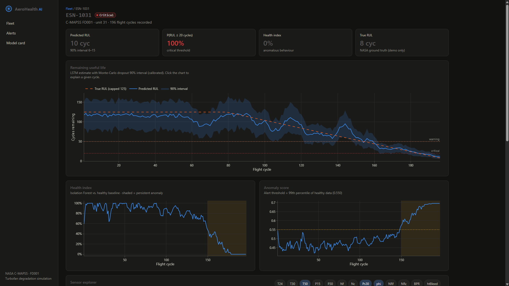
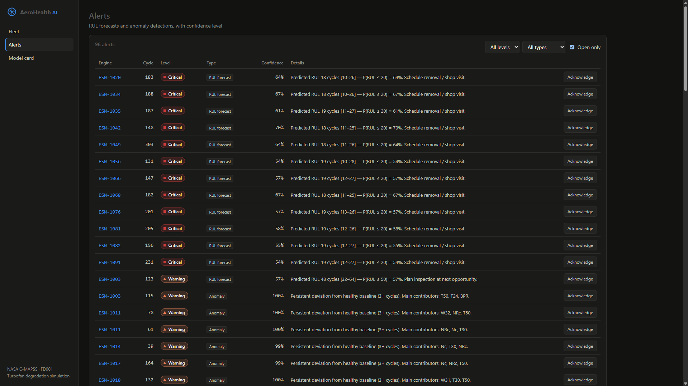
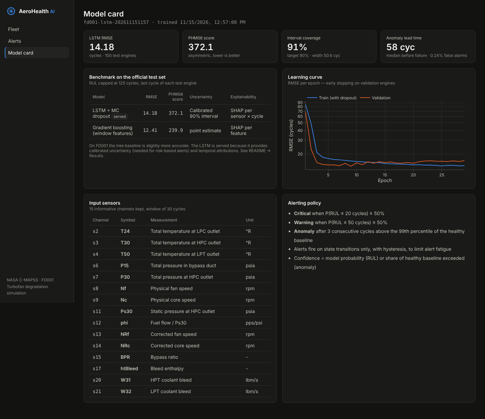

# AeroHealth AI — Predictive maintenance for turbofan engines

Engine health monitoring platform built on the NASA **C-MAPSS** turbofan degradation dataset.
It detects abnormal engine behaviour, forecasts the **Remaining Useful Life (RUL)** with a calibrated
confidence interval, explains every prediction with **SHAP**, and raises risk-based alerts in a
dashboard designed for a maintenance engineer.



| | |
|---|---|
| **ML / DL** | PyTorch LSTM · Monte-Carlo dropout · Isolation Forest · SHAP (expected gradients) · scikit-learn |
| **Data** | pandas · operating-condition normalisation · sliding windows · PostgreSQL |
| **Backend** | FastAPI · SQLAlchemy 2 · Pydantic · pytest |
| **Frontend** | React · Plotly · Vite |
| **Ops** | Docker Compose · nginx · GitHub Actions CI |

---

## Results (FD001, official test set — 100 engines)

| Model | RMSE (cycles) | PHM08 score | Uncertainty | Explainability |
|---|---|---|---|---|
| **LSTM + MC dropout** (served) | **14.18** | 372 | calibrated 90 % interval — **91 % empirical coverage** | SHAP per sensor × cycle |
| Gradient boosting on window features (baseline) | 12.41 | 240 | none | SHAP per feature |

| Anomaly detection (validation engines) | |
|---|---|
| Engines with a persistent anomaly detected before failure | 100 % |
| Median lead time before failure | **58 cycles** |
| False-alarm rate on the healthy portion of life | 0.24 % of cycles |

**Honest reading.** On FD001 (one operating condition, one fault mode) a well-featured gradient-boosting
model beats the LSTM on point accuracy — consistent with the literature, where simple models are
competitive on this subset. The LSTM is served anyway because the product needs a **probability**
(“P(RUL ≤ 20 cycles) = 87 %”), not just a number, and temporal attributions. A natural next step is an
ensemble, or quantile gradient boosting, compared on the same coverage metric.

Published state-of-the-art on FD001 is roughly RMSE 11–13; this project targets a sound, explainable,
end-to-end system rather than leaderboard tuning.

---

## Screenshots

**Fleet overview** — engines ranked by risk, predicted RUL with 90 % interval, RUL vs. health index


**Engine view: sensors & explainability** — raw sensor trends with anomalous cycles shaded, SHAP attribution per sensor and per past cycle, alert history


**Alerts** — RUL and anomaly alerts with confidence level and acknowledgement


**Model card** — test-set benchmark, learning curve, input sensors, alerting policy


---

## How it works

```
C-MAPSS raw (21 sensors, 3 settings)
   │  normalise per operating condition (KMeans on settings for FD002/FD004)
   │  drop non-informative channels → 15 sensors kept on FD001
   ▼
30-cycle sliding windows ──► LSTM (2×64) ──► RUL, capped at 125 cycles
                                │  50 MC-dropout passes → mean, std
                                │  std rescaled on validation engines so the 90 % interval covers 90 %
                                ▼
                        P(RUL ≤ 20), P(RUL ≤ 50)  ──►  RUL alerts (CRITICAL / WARNING)

smoothed sensors ──► Isolation Forest fitted on healthy early life (first 30 %)
                        │  anomaly score, threshold = 99th pct of healthy data
                        │  Health Index = score rescaled healthy → end-of-life (1 → 0)
                        ▼
                    persistent anomaly (3 cycles)  ──►  ANOMALY alerts + top deviating sensors

SHAP GradientExplainer on the LSTM ──► contribution of each sensor at each past cycle
```

Key design decisions:

- **Piecewise-linear RUL target (cap 125).** Early in life, degradation is not observable; capping
  avoids asking the model to guess the unguessable. It is the standard C-MAPSS protocol.
- **Validation split by engine, not by row**, so no engine leaks between train and validation.
- **Calibrated uncertainty.** Raw MC-dropout intervals are too narrow; a single scale factor is fitted
  on held-out engines (split-conformal style) and checked on the test set (91 % for a 90 % target).
- **Alerts on state transitions with hysteresis**, not one per cycle — maintenance teams ignore noisy
  systems. Each alert carries a confidence: model probability for RUL alerts, share of the healthy
  baseline exceeded for anomaly alerts.
- **Causal processing only** (past cycles), so the same code works on a live data stream
  (`POST /api/engines/{id}/cycles`).

C-MAPSS sensor channels are mapped to their physical meaning (T24/T30/T50 temperatures, Ps30 HPC
static pressure, Nf/Nc spool speeds, BPR, bleed flows…) throughout the API and the UI. On FD001 the
simulated fault is **HPC degradation**, and channels driven by it — T24, T50, Ps30, phi,
corrected spool speeds — typically top the SHAP rankings near end of life.

---

## Quick start

### Docker (everything)

```bash
docker compose up --build
```

- Dashboard: http://localhost:3000
- API docs (Swagger): http://localhost:8000/docs

On first start the backend downloads C-MAPSS (~45 MB), uses the trained model shipped in
`backend/artifacts/` (retrains automatically if absent), loads the 100 FD001 test engines into
PostgreSQL and scores every cycle (~40 s).

### Local development

```bash
cd backend
pip install torch --index-url https://download.pytorch.org/whl/cpu
pip install -r requirements-dev.txt
python -m scripts.download_data
python -m aerohealth.ml.train --dataset FD001   # ~1-2 min on CPU
python -m aerohealth.api.seed --reset           # SQLite by default, set DATABASE_URL for Postgres
uvicorn aerohealth.api.main:app --reload
python -m pytest -q

cd ../frontend
npm install && npm run dev                      # http://localhost:5173
```

---

## API

| Method | Endpoint | Description |
|---|---|---|
| GET | `/api/fleet` | All engines with status, latest RUL + interval, health index, open alerts |
| GET | `/api/engines/{id}` | Engine detail and latest prediction |
| GET | `/api/engines/{id}/predictions` | Per-cycle RUL, interval, probabilities, health index, anomaly flags |
| GET | `/api/engines/{id}/sensors?sensors=s4,s11` | Raw sensor time series |
| GET | `/api/engines/{id}/explain?cycle=150` | SHAP attribution (per sensor and per sensor × cycle) |
| POST | `/api/engines/{id}/cycles` | Ingest a new flight cycle → re-score → new alerts |
| GET | `/api/alerts?level=&kind=&open_only=` | Alert history |
| PATCH | `/api/alerts/{id}/ack` | Acknowledge an alert |
| GET | `/api/model` | Model card: metrics, learning curve, features, thresholds |

---

## Project structure

```
backend/
  aerohealth/
    config.py            constants, thresholds, sensor dictionary
    ml/
      data.py            loading, RUL labelling, normalisation, windowing
      lstm.py            model, training loop, MC-dropout inference
      health.py          Isolation Forest, health index, anomaly persistence
      explain.py         SHAP GradientExplainer wrapper
      metrics.py         RMSE, PHM08 score, interval coverage
      predictor.py       inference facade used by the API
      train.py           end-to-end training + evaluation + baseline
    api/
      db.py              SQLAlchemy models (engines, readings, predictions, alerts)
      services.py        scoring orchestration and alert state machine
      main.py            FastAPI routes
      seed.py            loads the C-MAPSS test fleet
  artifacts/             trained model, preprocessor, metrics (meta.json)
  tests/                 unit + API tests
frontend/                React + Plotly dashboard (fleet, engine, alerts, model card)
docker-compose.yml       PostgreSQL + API + nginx
```

## Limitations & next steps

- C-MAPSS is a simulation; real engine data (ACARS/EHM snapshots) is sparser, noisier and has
  maintenance actions (water washes, module swaps) that reset degradation.
- Only FD001 is served. The pipeline already handles multi-condition subsets (`--dataset FD004`),
  which need more tuning.
- Ensemble / quantile gradient boosting to combine the baseline's accuracy with calibrated intervals.
- Model registry and drift monitoring (MLflow) for retraining in production.

## Data & references

- A. Saxena, K. Goebel, D. Simon, N. Eklund, *Damage Propagation Modeling for Aircraft Engine
  Run-to-Failure Simulation*, PHM 2008.
- NASA Prognostics Center of Excellence — C-MAPSS dataset.
- S. Lundberg, S.-I. Lee, *A Unified Approach to Interpreting Model Predictions*, NeurIPS 2017.
- Y. Gal, Z. Ghahramani, *Dropout as a Bayesian Approximation*, ICML 2016.

---

Steven Jansen — MSc Big Data & AI (IPSSI Paris) · BSc Aerospace Engineering (IPSA) · ATPL theory
